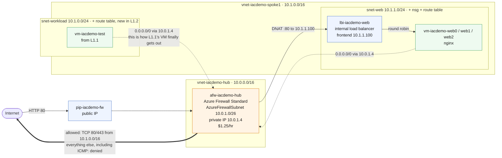

# L1.2 — Architecture Expansion 🟡

**📍 [Level 1 · Deploy](Curriculum-Level-1-Deploy.md)** · Chapter 2 of 4 &nbsp;·&nbsp; Previous: [L1.1 — Core Deployment](Curriculum-L1-1-Core-Deployment.md) &nbsp;·&nbsp; Next: [L1.3 — Multi-Service Application](Curriculum-L1-3-Multi-Service-Application.md)

---

**Goal:** add a real web tier to L1.1's network — three nginx VMs behind an **internal** load balancer — and put **Azure Firewall** in charge of all traffic in and out. That includes L1.1's test VM: L1.2 routes its subnet through the firewall too, which is what finally gives it internet access.

| Who this is for | Time | You need first | Cost while it runs |
|---|---|---|---|
| Lab 2 of 4 · everyone | ~20 min, 10 of it the firewall | L1.1 deployed, same prefix | 🟡 ~$1.65/hr running total |

> [!IMPORTANT]
> **L1.1 must already be deployed with the same prefix.** L1.2 writes a new subnet into L1.1's spoke VNet, and puts the firewall in the `AzureFirewallSubnet` that L1.1 reserved.

> [!WARNING]
> **This is the expensive lab.** Azure Firewall Standard is **$1.25/hr on its own** — more than everything else in all four labs combined — taking the running total from ~$0.24/hr to **~$1.65/hr**. It bills while deployed even when idle, so don't leave L1.2 up overnight.

## What you're building



<details><summary>Text description of this diagram</summary>

Inbound traffic arrives at the firewall's public IP on port 80. A **DNAT rule**
translates it to `10.1.1.100`, the private frontend of an **internal** load
balancer, which round-robins across three nginx VMs in `snet-web`
(`10.1.1.0/24`).

The load balancer is internal on purpose. A public one, combined with a route
table forcing egress through the firewall, would send return traffic out a
different path than it came in — asymmetric routing, and connections die
silently. Inbound via DNAT and outbound via the route table keeps both
directions on the firewall.

Outbound, both dashed lines are route tables sending `0.0.0.0/0` to the
firewall's private address `10.0.1.4`. The web subnet has one, and **L1.2 also
attaches the same route table to L1.1's `snet-workload`** — which is what finally
gives the L1.1 test VM internet access. The firewall allows TCP 80 and 443 from
`10.1.0.0/16` and denies everything else, so ICMP fails while HTTPS works.

Azure Firewall Standard costs **$1.25/hr on its own**, which is why the running
total jumps from about $0.24/hr to about $1.65/hr at this lab.

</details>

**Source:** [`curriculum/L1.2-architecture-expansion/main.bicep`](https://github.com/HybridCloudWorks/Demo-IaC_Demo_with_VSCode/blob/main/curriculum/L1.2-architecture-expansion/main.bicep) · [`curriculum/modules/subnet.bicep`](https://github.com/HybridCloudWorks/Demo-IaC_Demo_with_VSCode/blob/main/curriculum/modules/subnet.bicep)

> [!NOTE]
> **Why an internal load balancer?** A *public* LB in front of the VMs, while a route table forces egress through the firewall, causes asymmetric routing — return traffic leaves by a different path than it arrived, and connections die silently with no error to read. The correct hub-and-spoke pattern is the one used here: inbound through a firewall **DNAT rule** to an internal LB, outbound through the firewall via the route table. Both directions stay on the firewall.

<br>

## 🚀 Deploy it — pick any one of three ways

All three deploy the **same** template and give the **same** result.

<table>
<tr>
<td align="center" width="240"><br><br><b>1 · Bicep CLI</b><br><sub>Copy-paste in the terminal</sub></td>
<td align="center" width="240"><br><br><b>2 · GitHub Actions</b><br><sub>One button in the browser</sub></td>
<td align="center" width="240"><br><br><b>3 · GitHub Copilot</b><br><sub>Ask AI in plain English</sub></td>
</tr>
</table>

<br>

---

> [!NOTE]
> **🏫 Classroom: use Option 2 (GitHub Actions).** Your Azure account holds Reader, so the local `az deployment` commands in Options 1 and 3 will be refused — deploys go through your fork's workflow, which uses the shared workshop identity automatically. Compiling locally (`az bicep build`) works for everyone.

## &nbsp; Option 1 · Bicep from the terminal

**Best if you like the command line** (self-hosted only). Your values are already loaded from `lab-settings.csv` (set up in L1.1) — nothing to re-type.

```powershell
az deployment group what-if --resource-group $env:AZURE_RESOURCE_GROUP --parameters curriculum/L1.2-architecture-expansion/main.bicepparam
az deployment group create  --resource-group $env:AZURE_RESOURCE_GROUP --parameters curriculum/L1.2-architecture-expansion/main.bicepparam
```

**You should see:** about ten minutes of work — the firewall is the slow part — ending with `"provisioningState": "Succeeded"` and a `testUrl` output holding the firewall's public IP.

> [!TIP]
> New terminal? Re-run `./scripts/Load-LabSettings.ps1`, or use `-Persist` once so it happens automatically.

<br>

---

## &nbsp; Option 2 · GitHub Actions (push-button)

**Best if you'd rather click a button.** Classroom forks are pre-wired — nothing to set up; self-hosted needs the one-time `Setup-Oidc.ps1` ([Deployment Guide](Deployment-Guide.md)).

On GitHub: **Actions → "Curriculum L1.2 - Architecture Expansion" → Run workflow** (or `gh workflow run curriculum-l1-2-architecture-expansion.yml`).

**You should see:** **Lint → What-if → Deploy** run in order, then a final step printing your test URL.

<br>

---

## &nbsp; Option 3 · GitHub Copilot (plain English)

**Best if you'd rather describe the change** and have AI edit and deploy it. The deploy step is self-hosted only (classroom accounts hold Reader).

Copilot runs the deploy **locally**, so (self-hosted) load your values once first (same file as Option 1): `./scripts/Load-LabSettings.ps1`.

Open **Copilot Chat → Agent mode**:

> Deploy `curriculum/L1.2-architecture-expansion/main.bicep` to my lab resource group (`$env:AZURE_RESOURCE_GROUP`) with `az deployment group create`.

**Want to harden it first?** Ask:

> Limit the firewall's outbound rule to port 443 only (remove 80), run `az bicep build`, then deploy.

Copilot edits, verifies, and deploys — and fixes any error you paste back.

<br>

---

## ✅ Verify it

### Portal-only verify (no terminal)

<table>
<tr>
<td align="center" width="33%"><b>Mode</b><br><sub>Portal only</sub></td>
<td align="center" width="33%"><b>Time</b><br><sub>~5 minutes</sub></td>
<td align="center" width="33%"><b>Goal</b><br><sub>Confirm the firewall, web tier, and route table are wired correctly</sub></td>
</tr>
</table>

> [!IMPORTANT]
> You do **not** need PowerShell or Azure CLI for this check. Everything below is in the Portal.

<details open><summary><b>Step 1 · Confirm the resources are there</b></summary>

Open the resource group and look for:

- `afw-<prefix>-hub` - Azure Firewall
- `pip-<prefix>-fw` - Public IP
- `lbi-<prefix>-web` - Load Balancer
- `vm-<prefix>-web0`, `web1`, `web2`
- `vm-<prefix>-test`

**PASS:** all five items are present.

</details>

<details open><summary><b>Step 2 · Check the firewall</b></summary>

Open `afw-<prefix>-hub`.

**PASS:**

- Provisioning state is `Succeeded`
- A public IP is attached

</details>

<details open><summary><b>Step 3 · Check the load balancer</b></summary>

Open `lbi-<prefix>-web` -> **Backend pools**.

**PASS:** the backend pool has three VM NICs, one for each web VM.

</details>

<details open><summary><b>Step 4 · Check L1.1 got the route table</b></summary>

Open `vm-<prefix>-test` -> **Networking** -> **Network interface** -> **Effective routes**.

**PASS:** you see a `0.0.0.0/0` route and its next hop type is `Virtual appliance`.

</details>

<details open><summary><b>Step 5 · Open the web page</b></summary>

Open `pip-<prefix>-fw`, copy the IP address, and open `http://<that-ip>` in a browser tab.
Refresh a few times.

**PASS:** the page says `Hello from ...` and the hostnames rotate across `web0`, `web1`, and `web2`.

</details>

> [!TIP]
> If one item is missing, open the L1.2 run in the **Actions** tab, read the step that failed, and rerun L1.2.

>  **GitHub feature spotlight · Concurrency groups**
>
> **You just used it:** the L1.2 workflow declares `concurrency: { group: curriculum-l1-2 }`, so two people can't deploy into the same resource group at once — the second run queues instead of colliding mid-deployment.
> **Find it:** [`.github/workflows/curriculum-l1-2-architecture-expansion.yml`](https://github.com/HybridCloudWorks/Demo-IaC_Demo_with_VSCode/blob/main/.github/workflows/curriculum-l1-2-architecture-expansion.yml), and a queued run shows as *Pending* in the **Actions** tab.
> **Beyond the lab:** this is the cheapest deployment lock you will ever configure — no state file, no advisory lock, about three lines of YAML.
> [Docs →](https://docs.github.com/actions/using-jobs/using-concurrency)

<br>

---

## ➡️ What carries forward

L1.3 does **not** build on this lab. It creates its own spoke, peers it straight to L1.1's hub, and never routes through the firewall — so L1.2 is not a prerequisite for anything that follows. What carries forward is the **hub**, and the pattern you have just seen: put something in front of your workloads and make all traffic go through it.

For later `.1` chapters that can include this tier (for example L2.1 and L4.1), keep `CURRICULUM_INCLUDE_WEB_TIER` aligned with reality:

```powershell
$env:CURRICULUM_INCLUDE_WEB_TIER = "true"   # while L1.2 web tier is deployed
# $env:CURRICULUM_INCLUDE_WEB_TIER = "false" # after L1.2 teardown
```


> [!CAUTION]
> **Don't delete only the firewall.** Both spoke subnets now route `0.0.0.0/0` at its private IP, so removing it on its own black-holes all their outbound traffic — the web tier and L1.1's test VM go dark while still billing. Tear down **all of L1.2**, route table included, or run the full teardown. See [Cost & cleanup](https://github.com/HybridCloudWorks/Demo-IaC_Demo_with_VSCode/blob/main/README.md) in the README.

## 🧭 Where next?

| Your situation | Go to |
|---|---|
| Ready to keep going — containers, SQL and private networking | **[L1.3 — Multi-Service Application](Curriculum-L1-3-Multi-Service-Application.md)** |
| Save ~$1.41/hr first: tear this chapter down (L1.3 doesn't use it) | [Cleanup & Reset](Cleanup-and-Reset.md) |
| Want the big picture of Level 1 | [Level 1 · Deploy overview](Curriculum-Level-1-Deploy.md) |
| ⬅ Back to the main path | [🗺️ Curriculum Map](Curriculum-Map.md) |
| Something didn't work | [Troubleshooting](Troubleshooting.md) |
