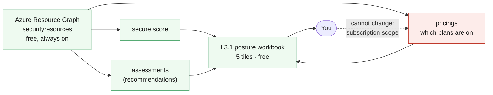

# L3.1 — Security Foundation 🟡

**📍 [Level 3 · Secure](Curriculum-Level-3-Secure.md)** · Chapter 1 of 4 &nbsp;·&nbsp; Previous: [L2.1 — Monitoring Fundamentals](Curriculum-L2-1-Monitoring-Fundamentals.md) &nbsp;·&nbsp; Next: [L4.1 — Backup Fundamentals](Curriculum-L4-1-Backup-Fundamentals.md) · Go deeper: [L3.2 — Workload Protection](Curriculum-L3-2-Workload-Protection.md)

---

**Goal:** find out where this environment actually stands, using only free
capability, before spending anything. You deploy one workbook and buy nothing.

**The IaC lesson:** every Azure resource type deploys at a specific scope —
this template targets a resource group, so a subscription-scoped resource like
`Microsoft.Security/pricings` is out of its reach no matter how correct the
code looks.

<br>

| Who this is for | Time | You need first | Cost while it runs |
|---|---|---|---|
| Chapter 1 of Level 3 · everyone | ~20 min | **Nothing** — this deploys on its own; the workbook simply shows more when more is deployed | 🟢 **$0.00/hr** — nothing in this chapter is billable |

> [!IMPORTANT]
> **Defender plans are not enabled here, and you cannot enable them.**
> `Microsoft.Security/pricings` is subscription-scoped — your account holds
> Reader, and even the deploy identity's Contributor stops at the resource
> group. Enabling plans is an instructor job.

<br>

## What you're building

One workbook, and nothing else. It reads three things — the secure score, the
assessments behind it, and which Defender plans are switched on — all from
Azure Resource Graph, which is free and already collecting. The dotted line
marks the one thing you can read but not change: the plan state lives at
subscription scope, above your permissions.



<details><summary>Text description of this diagram</summary>

One workbook, fed entirely by Azure Resource Graph rather than by Log
Analytics. Three query sources: the **secure score** for the subscription, the
**assessments** behind it (what Defender for Cloud calls recommendations), and
the **pricings** resource showing which Defender plans are enabled.

The dotted line records the permission boundary. You can *read* the plan state —
and you should, because it decides what half of Level 3 can detect — but you
cannot change it: the change lives at subscription scope, above both your
Reader role and the deploy identity's resource-group Contributor.

Everything here is free: foundational CSPM, secure score, recommendations,
Resource Graph and workbooks all cost nothing on any subscription.

</details>

**Source:** [`curriculum/L3.1-security-foundation/main.bicep`](https://github.com/HybridCloudWorks/Demo-IaC_Demo_with_VSCode/blob/main/curriculum/L3.1-security-foundation/main.bicep) · [`main.bicepparam`](https://github.com/HybridCloudWorks/Demo-IaC_Demo_with_VSCode/blob/main/curriculum/L3.1-security-foundation/main.bicepparam) · [`scripts/admin/Enable-DefenderPlans.ps1`](https://github.com/HybridCloudWorks/Demo-IaC_Demo_with_VSCode/blob/main/scripts/admin/Enable-DefenderPlans.ps1)

<br>

<details><summary><b>🔍 Going deeper — why Resource Graph, not the workspace</b></summary>

<br>

L2.2's workbook queried Log Analytics, and the obvious move here is to do the
same against `SecurityRecommendation` and `SecurityAlert`. Those tables are
**empty** until L3.3 turns on continuous export — a workspace-driven workbook
in this chapter would render five blank tiles. Secure score and assessments
live in Resource Graph's `securityresources` table from the moment foundational
CSPM is on, which is by default. Knowing which store holds which security data
is worth more than the workbook itself.

</details>

<details><summary><b>🔍 Going deeper — who can enable Defender plans, and why not you</b></summary>

<br>

`Microsoft.Security/pricings` is a **subscription**-scoped resource, and in
this lab your account holds Reader while the shared deploy identity holds
Contributor on **one resource group**. Turning plans on is an
instructor job — `scripts/admin/Enable-DefenderPlans.ps1`, run once per lab
subscription. That is not a gap in the lab; it is the same separation of
duties every real organisation has, and L3.2 is built around what you *can*
configure yourself.

</details>

<details><summary><b>🔍 Going deeper — the permissions this needs</b></summary>

<table>
<tr>
<td width="72" align="center" valign="top"></td>
<td valign="top">
<b>Azure RBAC — the minimum this chapter needs</b><br><br>
<b>Contributor</b> on the lab resource group to deploy the workbook. <b>Security Reader</b> at <b>subscription</b> scope to see the whole picture.<br>
<sub>Why: secure score and Defender assessments are subscription-scoped. With resource-group rights alone the workbook renders what it can see and the plan tile may come back empty — which is <i>no permission to look</i>, not <i>no plans enabled</i>. Your instructor needs <b>Security Admin</b> or <b>Owner</b> to enable plans at all; that is <code>scripts/admin/Enable-DefenderPlans.ps1</code>, not this template.</sub>
</td>
</tr>
<tr>
<td width="72" align="center" valign="top"></td>
<td valign="top">
<b>Microsoft Entra ID roles</b><br><br>
<b>None yet.</b><br>
<sub>Defender for Cloud roles are Azure RBAC, not directory roles. This changes at Level 5: Sentinel's Microsoft Entra ID connector needs a <b>Global Administrator</b> or <b>Security Administrator</b> in the directory, which is a different person in most organisations.</sub>
</td>
</tr>
</table>

<sub><a href="https://learn.microsoft.com/azure/defender-for-cloud/permissions">For more info</a> — Microsoft Defender for Cloud roles and permissions</sub>

</details>

<br>

---

> [!NOTE]
> **🏫 Classroom: use the GitHub Actions option.** Your Azure account holds
> Reader, so local `az deployment` commands will be refused — deploys go
> through your fork's workflow, which uses the shared workshop identity
> automatically. Compiling locally (`az bicep build`) works for everyone.

## 🚀 Deploy it — pick any one of three ways

<table>
<tr>
<td align="center" width="240"><br><br><b>1 · Bicep CLI</b><br><sub>Copy-paste in the terminal</sub></td>
<td align="center" width="240"><br><br><b>2 · GitHub Actions</b><br><sub>One button in the browser</sub></td>
<td align="center" width="240"><br><br><b>3 · GitHub Copilot</b><br><sub>Ask AI in plain English</sub></td>
</tr>
</table>

<br>

---

## &nbsp; Option 1 · Bicep from the terminal

```powershell
az deployment group what-if --resource-group $env:AZURE_RESOURCE_GROUP --parameters curriculum/L3.1-security-foundation/main.bicepparam
az deployment group create  --resource-group $env:AZURE_RESOURCE_GROUP --parameters curriculum/L3.1-security-foundation/main.bicepparam
```

**You should see:** a `costOfThisChapter` output reading `$0.00/hr`, and a
`whatIsNotHere` output naming the subscription-scoped thing you cannot deploy.

<br>

---

## &nbsp; Option 2 · GitHub Actions (push-button)

**Actions → "Curriculum L3 - Security & Defender for Cloud" → Run workflow →
L3.1 - Security Foundation**.

The run summary prints which Defender plans are on for the subscription. If the
identity cannot read them, it says so rather than implying they are off — a
blank list and "no permission to look" are very different answers, and confusing
them is how people conclude a subscription is unprotected when it isn't.

<br>

---

## &nbsp; Option 3 · GitHub Copilot (plain English)

Load your values first: `./scripts/Load-LabSettings.ps1`. Then in
**Copilot Chat → Agent mode**:

> Deploy `curriculum/L3.1-security-foundation/main.bicep` to my lab resource group (`$env:AZURE_RESOURCE_GROUP`) with `az deployment group create`.

**Then ask it for a safe, free change:**

> In `curriculum/L3.1-security-foundation/main.bicep`, update the workbook so the "Unhealthy recommendations" table shows only High and Medium severity findings, sorted by severity then count. Run `az bicep build` and deploy.

This keeps the exercise in resource-group scope, costs nothing, and still
teaches the Level 3 skill: review AI-generated infrastructure changes before
you deploy them.

<br>

---

## ✅ Verify it

<table>
<tr>
<td align="center" width="33%"><b>Mode</b><br><sub>Portal only</sub></td>
<td align="center" width="33%"><b>Time</b><br><sub>~5 minutes</sub></td>
<td align="center" width="33%"><b>Goal</b><br><sub>See real security posture and priority gaps</sub></td>
</tr>
</table>

> [!IMPORTANT]
> This chapter is about **seeing risk clearly first**. You are not expected to fix everything here.

<details open><summary><b>Step 1 · Open the workbook</b></summary>

Go to **Azure Monitor -> Workbooks** and open `L3.1 — <prefix> security posture`.

**PASS:** you can see all three panels:

- secure score,
- unhealthy recommendations,
- recommendations mapped to resources.

</details>

<details open><summary><b>Step 2 · Check score and top risks</b></summary>

In the workbook, read the **Secure score** panel, then the **Unhealthy recommendations** panel.

**PASS:** you can name your top 3 recommendations by impact.

</details>

<details open><summary><b>Step 3 · Confirm which recommendations hit your resources</b></summary>

Still in the workbook, review the panel that links findings to specific resources.

**PASS:** you can point to at least one finding on a real lab resource (for example the VM, SQL, or Key Vault).

</details>

<details open><summary><b>Step 4 · Map one recommendation to a benchmark control</b></summary>

Open **Defender for Cloud -> Regulatory compliance** and find the control for one high-severity recommendation.

**PASS:** you can explain which control it maps to and whether mitigation looks architectural (template change) or operational (policy/process).

</details>

<details><summary><b>Step 5 · Optional: check Defender plan coverage</b></summary>

In **Defender for Cloud -> Environment settings -> Defender plans**, review which plans are enabled.

**PASS:** you can tell which findings are from free foundational posture and which require paid plan features.

</details>

> [!TIP]
> If workbook data looks empty, refresh once and wait a few minutes. Secure score and assessments can lag briefly after deployment.

<br>

>  **GitHub feature spotlight · Least privilege in the pipeline, too**
>
> **You just hit it:** the workshop's shared deploy identity holds Contributor
> on each student's resource group — deliberately, while you yourself hold only
> Reader. That is why this chapter's workflow can deploy a workbook and cannot
> enable a Defender plan, and why the deploy fails loudly instead of quietly
> widening its own access.
> **Find it:** self-hosted users create their own identity with
> `scripts/Setup-Oidc.ps1`, which says in its own header that it has no
> subscription-scoped mode.
> **Beyond the lab:** a CI identity that can do everything is the fastest way to
> turn a compromised workflow into a compromised tenant. The right amount of
> friction here is *some*.
> [Docs →](https://docs.github.com/actions/deployment/security-hardening-your-deployments/about-security-hardening-with-openid-connect)

<br>

---

## ➡️ What carries forward

On the main path, L4.1 protects the same estate against loss instead of attack.
Going deeper, L3.2 turns on the protection that genuinely can be enabled at
resource scope — per-resource Defender settings on the SQL server, and
just-in-time access on the VMs — and prices each one before enabling it. The
recommendations you ranked here are the list it works from.

<br>

## 🧭 Where next?

| Your situation | Go to |
|---|---|
| Continue the main path — protect the estate against loss | **[L4.1 — Backup Fundamentals](Curriculum-L4-1-Backup-Fundamentals.md)** |
| Go deeper into security — turn on the protection you can | [L3.2 — Workload Protection](Curriculum-L3-2-Workload-Protection.md) |
| See every chapter, its needs and its cost | [🗺️ Curriculum Map](Curriculum-Map.md) |
| Want the big picture of this level first | [Level 3 · Secure overview](Curriculum-Level-3-Secure.md) |
| Done for the day — the estate bills while idle | [Cleanup & Reset](Cleanup-and-Reset.md) |
| Something didn't work | [Troubleshooting](Troubleshooting.md) |
