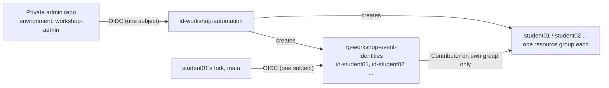

# Instructor Environment Setup

Stand the whole classroom environment up in **any Entra tenant and any Azure subscription**, run the class, and tear it all down again, without editing a single file in this repository. Everything tenant-specific comes from parameters, a roster CSV you keep private, and repository variables.

> [!IMPORTANT]
> **The TechCon-era shared identity is retired.** That event ran every fork through one shared app registration whose trust was a name pattern (`repo:User*-TechCon@*/…`). Anyone able to register a matching GitHub account could fork the repo and get a token. Its tenant is no longer reachable, so there is nothing to clean up from here, but **do not recreate that design**: no shared deploy identity, and no wildcard or name-pattern federated credential, ever. The setup on this page gives each student their own identity that trusts exactly one fork.

---

## What gets built

| Per student | Details |
|---|---|
| **Resource group** | Named after the student's GitHub username (for example `student01`), the group the curriculum workflows target by default, so the fork needs no resource-group setting |
| **Deploy identity** | A user-assigned managed identity, `id-<username>`, kept in the event's identity group `rg-workshop-<event>-identities`, where students hold no role |
| **Federated credential** | Exactly one, for the `main` branch of the student's own fork. An explicit subject, never a pattern |
| **Role** | Contributor on the student's own resource group, and nothing anywhere else |
| **Portal access** *(optional)* | Reader on the same group for the student's Entra account, if the roster has one (needed to sign in to the VM through Bastion) |

Once per subscription, for the automation:

| Automation | Details |
|---|---|
| **Identity** | `id-workshop-automation` in `rg-workshop-automation`, with one federated credential: your **private** admin repository's `workshop-admin` environment |
| **Roles** (subscription scope) | A custom role, *Workshop Environment Operator*, that can only create, read and delete resource groups and managed identities; plus **Role Based Access Control Administrator** with a condition: it may only add or remove **Contributor**, only for **service principals**, and **never for itself** |
| **Lock** | A ReadOnly lock on `rg-workshop-automation`, so the identity cannot add a federated credential to itself |
| **Microsoft Graph** | **None.** No Graph permission, no admin consent, no Entra administrator role needed anywhere |



<details><summary>Text description of this diagram</summary>

Your private admin repository signs in, through one federated credential bound to its workshop-admin environment, as the automation identity. The automation identity creates the event's identity resource group, holding one managed identity per student, and one resource group per student. Each student's fork signs in, through one federated credential bound to that fork's main branch, as that student's own identity, which holds Contributor on that student's resource group only.

</details>

**Why managed identities and not app registrations.** One app with a credential per fork runs into Entra's limit of 20 federated credentials per app, which is what pushed the old setup to a wildcard. One identity per student needs only one credential each, so the limit never matters. Managed identities are also Azure resources rather than directory objects: creating them needs no Graph permission, they cannot hold client secrets, Entra does not accept wildcards in their credentials at all, and deleting the resource groups removes every trace.

**Why the subject has numbers in it.** GitHub repositories created after 15 July 2026, which includes every fork made for a new event, present an ID-enriched OIDC subject: `repo:<user>@<user-id>/Demo-IaC_Demo_with_VSCode@<repo-id>:ref:refs/heads/main`. The scripts read both IDs from GitHub's public API and write that exact string. A credential for the old name-only form (`repo:<user>/Demo-IaC_Demo_with_VSCode:ref:refs/heads/main`) never matches a new fork, and the login fails with `AADSTS700213`. Older forks still present the name-only form; the default `-SubjectFormat Auto` picks the right one per fork from its creation date.

---

## Prerequisites

| You need | Notes |
|---|---|
| **An Azure subscription where you are Owner** | Only for the one-time bootstrap. Use a subscription that holds nothing but workshops (see *Residual risk* below) |
| **No Entra admin role** | Nothing here touches Microsoft Graph |
| **A GitHub account or organization** for a **private** copy of this repo | Environments on private repositories need GitHub Pro, Team or Enterprise; required reviewers on a private repository need GitHub Enterprise. On GitHub Free, run the scripts locally instead (step 4, *locally*) |
| **PowerShell 7.2+, Azure CLI, GitHub CLI** | `winget install Microsoft.PowerShell Microsoft.AzureCLI GitHub.cli`, then `az login --tenant <tenant-id>` and `gh auth login` |
| **A region other than Malaysia South** | Federated credentials on managed identities are not available there yet |

---

## 1. Make a private admin copy (once)

The workflow that builds the class handles the roster, and a public repository's Actions logs and artifacts are public. So it runs only from a private copy; it refuses to start in a public one. A fork of a public repository is always public, so make a copy instead:

```powershell
gh repo create MyOrg/workshop-admin --private
git clone https://github.com/HybridCloudWorks/Demo-IaC_Demo_with_VSCode.git workshop-admin
cd workshop-admin
git remote set-url origin https://github.com/MyOrg/workshop-admin.git
git push -u origin main
```

In the copy: **Settings → Environments → New environment** named `workshop-admin`. Under **Deployment branches and tags** choose *Selected branches* and add `main`. Add yourself under **Required reviewers** (with *Prevent self-review* off if you are the only instructor) where your plan allows it on a private repository. Without required reviewers, the protection is that only people with write access to this private repo can start the workflow, and only from `main`.

Prefer not to use Actions at all? Skip steps 1 and 2: `New-WorkshopEnvironment.ps1` and `Remove-WorkshopEnvironment.ps1` run locally under your own `az login` as a subscription Owner (step 4, *locally*). The automation identity exists only for the workflow.

## 2. Bootstrap the automation identity (once per subscription)

Signed in as a subscription Owner, from the private copy:

```powershell
./scripts/admin/New-WorkshopBootstrap.ps1 -TenantId <tenant-id> -SubscriptionId <subscription-id> `
    -AdminRepository MyOrg/workshop-admin -WhatIf     # preview
./scripts/admin/New-WorkshopBootstrap.ps1 -TenantId <tenant-id> -SubscriptionId <subscription-id> `
    -AdminRepository MyOrg/workshop-admin
```

It creates the automation identity, its single federated credential, the custom role, both role assignments and the lock, then **prints** the commands to configure the admin repository (it never runs them):

| Name | Kind | Value |
|---|---|---|
| `AZURE_CLIENT_ID` | variable | the automation identity's client ID (printed) |
| `AZURE_TENANT_ID` | variable | your tenant ID |
| `AZURE_SUBSCRIPTION_ID` | variable | your subscription ID |
| `WORKSHOP_EVENT_NAME` | variable | a short event name, 3–32 letters, digits and hyphens, for example `MyEvent` |
| `WORKSHOP_LOCATION` | variable *(optional)* | default `eastus2` |
| `WORKSHOP_RESOURCE_GROUP_PREFIX` | variable *(optional)* | see *Resource group names* below |
| `WORKSHOP_ROSTER_CSV` | **secret** | the roster file's contents (step 3) |

Set them on the `workshop-admin` environment where your plan supports environment variables and secrets, otherwise on the repository. Add `-AllowStudentPortalAccess` to the bootstrap if you want the automation to be allowed to grant Reader to student user accounts as well (see step 4).

> [!WARNING]
> **Residual risk: read before you use a shared subscription.** An Azure role-assignment condition can limit *which role* and *which kind of principal*, but not *which scope*. So the automation identity, if someone could run it with their own instructions, could create a managed identity and give it Contributor on the **whole subscription**. Three things keep that contained: the identity trusts only your private repo's `workshop-admin` environment; the environment only deploys from `main` (and, with Enterprise, only after a reviewer approves); and the subscription should hold **nothing but workshops**. Turn on an Activity Log alert for role assignments written at subscription scope if you want to be told.

## 3. Collect the roster

Ask each student for their **GitHub username** and to **fork this repository** before class (the fork must exist before its credential can be written: the subject contains the fork's repository ID). Then copy `scripts/admin/workshop-roster.csv.example` to `scripts/admin/workshop-roster.csv`:

```csv
GitHubUsername,EntraUpn,AzurePrefix,Repository
student01,,,
student02,student02@contoso.onmicrosoft.com,,
student03,,stu03,
```

| Column | Required | Meaning |
|---|---|---|
| `GitHubUsername` | yes | The student's GitHub login |
| `EntraUpn` | no | The student's account in your tenant: gets Reader on their group for the portal and Bastion |
| `AzurePrefix` | no | Resource-name prefix, 2–12 lowercase letters and digits. Derived from the username when empty, and always unique within the roster |
| `Repository` | no | The fork's name, if the student renamed it. Default `Demo-IaC_Demo_with_VSCode` |

> [!IMPORTANT]
> **The roster is personal data, and this repository is public.** `workshop-roster*.csv` and `workshop-client-ids*.csv` are gitignored everywhere in the tree; keep it that way. Never paste the roster into an issue, a pull request, a workflow file or a chat. For the workflow it lives only in the `WORKSHOP_ROSTER_CSV` secret:
> ```powershell
> Get-Content -Raw scripts/admin/workshop-roster.csv | gh secret set WORKSHOP_ROSTER_CSV --repo MyOrg/workshop-admin --env workshop-admin
> ```
> The scripts print row labels (`student 03`) instead of names, and under Actions they also mask every roster value. Locally, `-ShowNames` shows names on your own console.

## 4. Plan, then create

**With the workflow** (private copy): **Actions → Workshop environment (instructor) → Run workflow**.

1. `action: plan` — shows every change, makes none. Read the counts: students, forks found, what would be created.
2. `action: create` — builds or repairs everything. The run's **workshop-client-ids** artifact (private repos only, kept one day) holds one row per student.

**Locally** (same scripts, your own `az login`):

```powershell
./scripts/admin/New-WorkshopEnvironment.ps1 -EventName MyEvent -SubscriptionId <subscription-id> -TenantId <tenant-id> -WhatIf
./scripts/admin/New-WorkshopEnvironment.ps1 -EventName MyEvent -SubscriptionId <subscription-id> -TenantId <tenant-id>
```

It writes `scripts/admin/workshop-client-ids.csv` (gitignored). A local run as yourself can also grant the optional portal Reader: the automation identity has no Graph permission, so it cannot look up an `EntraUpn` and the workflow reports those rows as skipped.

Each row ends in one of these states:

| Status | Meaning | Do |
|---|---|---|
| `ready` | Identity, credential and role are in place | Hand out the row |
| `waiting-for-fork` | No fork found under that username yet, so no credential | Have the student fork, then re-run `create` — nothing else is repeated |
| `planned` | Plan mode | Run `create` |
| `failed` | That row stopped; the log says why (for example, a resource group with that name exists but is not tagged for this event — it is never adopted) | Fix it and re-run |

Re-running is always safe: it is how you add late students, pick up late forks, and repair anything. A fork deleted and re-created gets a new repository ID; the next run updates that student's credential.

**Resource group names.** By default a student's group is named exactly like their GitHub account, which the curriculum workflows already target, so the student sets nothing for it. To use a prefix instead (for example `rg-techdemo-`, which `Set-LabPolicy.ps1` looks for), set `WORKSHOP_RESOURCE_GROUP_PREFIX` or pass `-ResourceGroupPrefix`; those students must then also set the `AZURE_RESOURCE_GROUP` secret, and the output says so per row (`ResourceGroupSecretNeeded`).

## 5. Give each student their values

Send each student **their own row**, privately (a direct message or email, never a shared channel). They add four or five **repository variables** on their fork — **Settings → Secrets and variables → Actions → Variables**, or:

```powershell
$fork = '<their-username>/Demo-IaC_Demo_with_VSCode'
gh variable set AZURE_CLIENT_ID       --repo $fork --body <AZURE_CLIENT_ID>
gh variable set AZURE_TENANT_ID       --repo $fork --body <AZURE_TENANT_ID>
gh variable set AZURE_SUBSCRIPTION_ID --repo $fork --body <AZURE_SUBSCRIPTION_ID>
gh variable set AZURE_PREFIX          --repo $fork --body <AZURE_PREFIX>
gh variable set AZURE_LOCATION        --repo $fork --body <AZURE_LOCATION>
# only when ResourceGroupSecretNeeded = yes:
gh secret set AZURE_RESOURCE_GROUP    --repo $fork      # prompts for the value
```

None of these is a credential: each identity accepts tokens from one fork's `main` branch and nothing else, so a client ID on its own lets nobody in. The workflows read a **secret** of the same name before the variable, so a fork that once ran `Setup-Oidc.ps1` must delete its old `AZURE_*` secrets (`gh secret delete AZURE_CLIENT_ID --repo $fork`, and so on).

**Forks you administer** (pre-staged workshop accounts, or forks in your organization): add `-SetForkVariables` to a **local** create run and it sets those variables for you, and warns about any stale secret.

## 6. Run the class

Students enable workflows on their fork (**Actions** tab → *I understand my workflows, go ahead and enable them*) and run **Curriculum L1.1 – Core Deployment**. From here the [Start-Here Checklist](Start-Here-Checklist.md) and the chapter pages take over.

| Symptom | Cause | Fix |
|---|---|---|
| Stops at *Check Azure sign-in settings* | The fork is missing a variable | Step 5 |
| `AADSTS700213: No matching federated identity record` | The fork presents a different subject than the credential holds | The failed run's *Federated token details* log shows the subject GitHub sent. Compare it with that row's `FederatedSubject`. Usually: run from the wrong fork or branch; the fork was re-created (re-run create); or an older fork opted into immutable subjects (re-run with `-SubjectFormat Immutable`) |
| `AADSTS70021` right after create | The new credential is still replicating | Wait a few minutes and re-run the workflow |
| `AuthorizationFailed` on deploy | The run targets a group the identity cannot write to | Check `AZURE_RESOURCE_GROUP` (or the fork owner) against the row |
| A chapter needs a role beyond Contributor | L5's Microsoft Sentinel Contributor, for example | Grant it yourself, to that student's identity on their group only: `az role assignment create --assignee-object-id <PrincipalId> --assignee-principal-type ServicePrincipal --role "Microsoft Sentinel Contributor" --scope <their group's ID>` |

The automation identity cannot grant anything but Contributor, by design; chapter-specific roles are a deliberate, local instructor step.

## 7. Destroy

Deletes everything `create` made for the event, selected **by tag only** (`ManagedBy=workshop-environment` and `Event=<event>`), and nothing else: student groups with whatever the labs deployed in them, then the identity group with every identity and credential. The automation group is never touched.

**With the workflow:** run it with `action: destroy`. Without confirmation it previews; set `confirm_event` to the exact event name to delete.

**Locally:**

```powershell
./scripts/admin/Remove-WorkshopEnvironment.ps1 -EventName MyEvent -SubscriptionId <subscription-id> -WhatIf
./scripts/admin/Remove-WorkshopEnvironment.ps1 -EventName MyEvent -SubscriptionId <subscription-id>
```

Pass `-RosterPath` with a smaller roster to remove only those students. Each student identity loses its role assignment first, so access ends even if a group refuses to delete. A group usually refuses because of a **Recovery Services vault still holding backup items** (L4: soft delete keeps deleted backups for 14 days) or a resource lock; fix that and re-run, and only what is left is retried. Key Vaults are soft-deleted too: a student who repeats the course within the retention period with the same prefix hits a name conflict in L1.3, so give them a new `AzurePrefix` or purge the vault (`az keyvault purge`).

Afterwards, delete the client-ID file and the roster secret. To remove the automation itself (rarely needed; it is reusable for the next event):

```powershell
az lock delete --name workshop-automation-readonly --resource-group rg-workshop-automation
$p = az identity show --resource-group rg-workshop-automation --name id-workshop-automation --query principalId -o tsv
az role assignment delete --ids (az role assignment list --all --assignee $p --query "[].id" -o tsv)
az group delete --name rg-workshop-automation
az role definition delete --name "Workshop Environment Operator (<first 8 characters of the subscription ID>)" --scope /subscriptions/<subscription-id>
```

---

## Files

| File | Purpose |
|---|---|
| [`scripts/admin/New-WorkshopBootstrap.ps1`](https://github.com/HybridCloudWorks/Demo-IaC_Demo_with_VSCode/blob/main/scripts/admin/New-WorkshopBootstrap.ps1) | One-time, local: the automation identity, its roles and lock |
| [`scripts/admin/New-WorkshopEnvironment.ps1`](https://github.com/HybridCloudWorks/Demo-IaC_Demo_with_VSCode/blob/main/scripts/admin/New-WorkshopEnvironment.ps1) | Plan / create per-student groups, identities, credentials and roles |
| [`scripts/admin/Remove-WorkshopEnvironment.ps1`](https://github.com/HybridCloudWorks/Demo-IaC_Demo_with_VSCode/blob/main/scripts/admin/Remove-WorkshopEnvironment.ps1) | Destroy by tag |
| [`scripts/admin/WorkshopEnvironment.psm1`](https://github.com/HybridCloudWorks/Demo-IaC_Demo_with_VSCode/blob/main/scripts/admin/WorkshopEnvironment.psm1) | Shared helpers: roster, redaction, subjects |
| [`scripts/admin/workshop-roster.csv.example`](https://github.com/HybridCloudWorks/Demo-IaC_Demo_with_VSCode/blob/main/scripts/admin/workshop-roster.csv.example) | Roster template |
| [`.github/workflows/workshop-environment.yml`](https://github.com/HybridCloudWorks/Demo-IaC_Demo_with_VSCode/blob/main/.github/workflows/workshop-environment.yml) | The `plan` / `create` / `destroy` workflow |

These replace `New-LabEnvironment.ps1` and `Setup-OidcAll.ps1`, which derived GitHub accounts from Entra UPNs, wrote name-only subjects that new forks never present, and needed admin rights on every student fork. Policy guardrails and Defender plans are unchanged: see [Instructor Admin Tools](Instructor-Admin-Tools.md).

<br>

---

>  **GitHub feature spotlight · Environments as a gate**
>
> **You just used it:** the `workshop-admin` environment is both the lock and the key. The automation identity's federated credential names it, so only a job that declares it can sign in, and its rules decide who may start that job and from which branch.
> **Find it:** your admin copy → **Settings → Environments → workshop-admin**, and `environment: workshop-admin` in `.github/workflows/workshop-environment.yml`.
> **Beyond the lab:** put production credentials behind an environment, not a repository secret: the OIDC subject then proves which gate a run passed through.
> [Docs →](https://docs.github.com/actions/how-tos/deploy/configure-and-manage-deployments/manage-environments)
